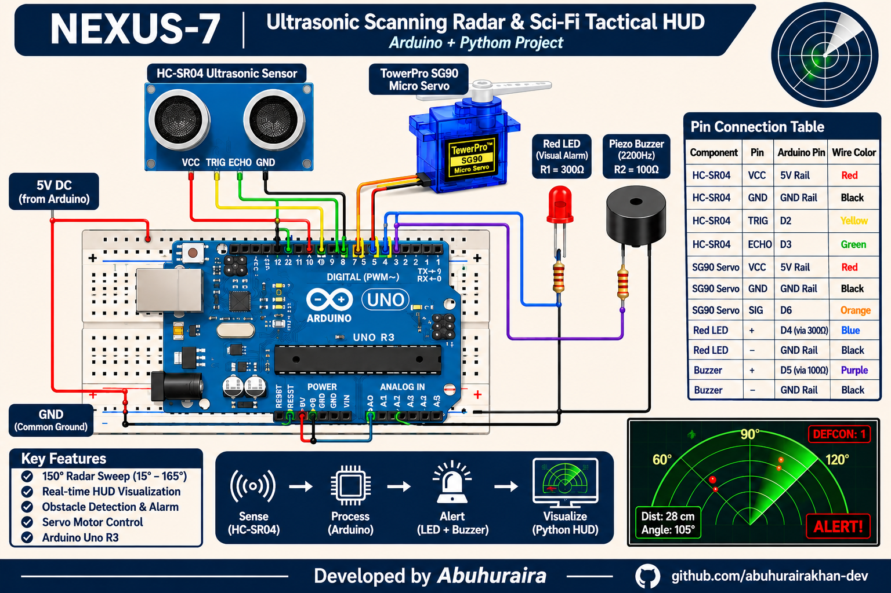

# NEXUS-7 // Tactical Ultrasonic Radar & Sci-Fi HUD

[](https://www.python.org/)
[](https://www.arduino.cc/)
[](https://platformio.org/)
[](https://www.pygame.org/)
[](LICENSE)

An interactive cyber-physical ultrasonic radar platform. Pairs an **Arduino Uno R3**, **SG90 micro-servo**, **HC-SR04 ultrasonic rangefinder**, and an **autonomous dual visual/acoustic alarm subsystem** with a real-time, movie-grade **Sci-Fi Tactical HUD Visualizer** rendered in Python using Pygame and NumPy.

---

## Circuit Schematic & System Overview



> **Schematic Downloads:**
> - [Electrical Engineering & Pinout Guide](docs/CIRCUIT_GUIDE.md)

---

## Key Features

* **Cinematic Tactical HUD**:
  * Sweeping polar radar beam with phosphor persistence trail and ion particles.
  * Multi-tier range rings (10 cm to 50 cm) with pulsing perimeter alert boundary.
  * Spatial target clustering with military tracking reticles (`[TGT-A01]`, bearing, range, lock status).
  * Live 40 kHz acoustic waveform oscilloscope & 60-sample historical waterfall graph.
  * DEFCON threat level matrix (DEFCON 1 Combat Alert through DEFCON 5 Nominal).
* **4 Futuristic Visual Palettes**:
  * `CYAN ASTRAL` — Tron / Jarvis holographic blue.
  * `TACTICAL EMERALD` — Classic military sonar / Predator war-room green.
  * `SOLARIS AMBER` — Weyland-Yutani Nostromo industrial CRT.
  * `CRIMSON RED ALERT` — DEFCON 1 tactical combat mode.
* **Procedural Sound FX (Zero External Files)**:
  * Resonant sonar sweep pings, proximity alert klaxons, and target-acquisition lock chirps synthesized directly in real-time using NumPy into 44.1 kHz 16-bit audio.
* **Autonomous Hardware Defense**:
  * Real-time acoustic trigger detects intruders within 30.0 cm (configurable).
  * Synchronous optical (high-brightness red LED) and acoustic (2200 Hz pulsed piezo buzzer) alarm strobing at 120 ms intervals without interrupting servo sweep motion.
* **Dual Operation Modes**:
  * **Live Serial Telemetry**: Auto-detects Arduino USB-UART connections at 115200 baud.
  * **Autonomous Simulation**: Built-in physics engine with patrolling drones, obstacle reflection, and interactive mouse-click target placement.
* **Bidirectional Serial Control**:
  * Adjust alert distance (`ALERT:25`), scan step (`STEP:2`), or trigger hardware tests (`TEST`) directly from the HUD.

---

## Hardware Bill of Materials (BOM) & Pinout

### Components

| Component | Part / Spec | Qty | Operating Range | Function |
|---|---|:---:|---|---|
| **Microcontroller** | Arduino Uno R3 (ATmega328P) | 1 | 5.0 V DC via USB / VIN | Sensor scheduling, sweep control & telemetry |
| **Ultrasonic Sensor**| HC-SR04 | 1 | 2 cm – 400 cm (40 kHz beam) | Distance measurement |
| **Actuator** | TowerPro SG90 Micro Servo (9g) | 1 | 15° to 165° horizontal sweep | Sweeps the ultrasonic sensor platform |
| **Visual Alarm** | 5mm High-Brightness Red LED | 1 | $V_f \approx 2.0\text{ V}$, ~10 mA | Flashes on proximity intrusion |
| **Acoustic Alarm** | Passive Piezo Buzzer | 1 | 2200 Hz tone, ~25 mA | Emits audible alarm pulse |
| **Resistor R1** | 300 Ω (1/4W, $\pm 5\%$) | 1 | Limits LED current to ~10 mA | Ballast resistor for Pin D4 |
| **Resistor R2** | 100 Ω (1/4W, $\pm 5\%$) | 1 | Damps piezo back-EMF spikes | Current limiter for Pin D5 |
| **Breadboard** | Half-size solderless breadboard | 1 | Standard 2.54 mm pitch | Power bus distribution & interconnects |

### Pin Interconnection Matrix

| Component | Component Pin | Arduino Uno Destination | Wire Color | Signal / Characteristic |
|---|---|---|---|---|
| **Power Rail** | +5V Bus Rail | Arduino **5V Pin** | **Red** | +5.0V Regulated DC Rail |
| **Ground Rail**| GND Bus Rail | Arduino **GND Pin** | **Black** | Common Ground (0V Return) |
| **HC-SR04** | VCC | Breadboard (+) Rail | **Red** | +5V DC Supply |
| **HC-SR04** | GND | Breadboard (-) Rail | **Black** | Ground Return |
| **HC-SR04** | TRIG | Arduino **Pin D2** | **Yellow** | 10 µs Active-HIGH Trigger Pulse |
| **HC-SR04** | ECHO | Arduino **Pin D3** | **Green** | Return Echo Pulse Width Duration |
| **SG90 Servo** | Red Wire | Breadboard (+) Rail | **Red** | +5V DC Motor Power |
| **SG90 Servo** | Brown Wire | Breadboard (-) Rail | **Brown/Black** | Ground Return |
| **SG90 Servo** | Orange Wire | Arduino **Pin D6** | **Orange** | 50 Hz PWM Sweep Control (15°–165°) |
| **Red LED** | Anode (+) via 300 Ω | Arduino **Pin D4** | **Blue** | Active-HIGH Visual Alarm (~10 mA) |
| **Red LED** | Cathode (-) | Breadboard (-) Rail | **Black** | Ground Return |
| **Piezo Buzzer**| Positive (+) via 100 Ω | Arduino **Pin D5** | **Purple** | 2200 Hz Tone Frequency on Alert |
| **Piezo Buzzer**| Negative (-) | Breadboard (-) Rail | **Black** | Ground Return |

---

## Quick Start

### 1. Flash the Arduino Firmware

* **Using Arduino IDE**:
  1. Open `arduino_radar/arduino_radar.ino`.
  2. Select **Board: Arduino Uno** and your **COM Port**.
  3. Click **Upload**.

* **Using PlatformIO CLI**:
  ```bash
  pio run --target upload
  ```

### 2. Run the Sci-Fi HUD Visualizer

* **Install dependencies**:
  ```bash
  pip install -r requirements.txt
  ```

* **Launch**:
  * **Windows 1-Click**: Double-click `run_visualizer.bat`
  * **Command Line (Auto-detects USB port)**:
    ```bash
    python radar_scifi_hud.py
    ```
  * **Command Line (Explicit COM Port)**:
    ```bash
    python radar_scifi_hud.py --port COM3 --baud 115200
    ```
  * **Standalone Simulation Mode (No hardware needed)**:
    ```bash
    python radar_scifi_hud.py --sim
    ```

### 3. Verify Hardware Circuit (Optional)

Test your physical wiring, servo motion, ultrasonic range readings, and alarm outputs:
```bash
python test_hardware.py
```
*(Or double-click `test_real_circuit.bat` on Windows)*

---

## Telemetry & Serial Command Protocol

### Telemetry Stream (Arduino $\rightarrow$ Host @ 115200 Baud)
```text
angle_deg: <INT>, distance_cm: <FLOAT|out_of_range>, alert: <0|1>
```
*Example:* `angle_deg: 45, distance_cm: 23.4, alert: 1`

### Control Commands (Host $\rightarrow$ Arduino)
| Command | Payload Range | Description |
|---|---|---|
| `ALERT:<cm>` | `5.0` to `200.0` | Dynamically updates alarm distance threshold |
| `STEP:<deg>` | `1` to `5` | Configures servo angular step size per measurement |
| `SPEED:<ms>` | `30` to `300` | Adjusts sweep step delay in milliseconds |
| `TEST` | N/A | Pulses LED and buzzer for 150 ms to test alarm |
| `STATUS` | N/A | Returns active firmware configuration parameters |

---

## Keyboard Shortcuts & HUD Controls

| Key | HUD Button | Action |
|:---:|:---:|---|
| <kbd>M</kbd> | `[M] MODE` | Toggle between **Live Serial** and **Simulation Mode** |
| <kbd>C</kbd> | `[C] THEME` | Cycle color theme (**Cyan** $\rightarrow$ **Emerald** $\rightarrow$ **Amber** $\rightarrow$ **Red Alert**) |
| <kbd>S</kbd> | `[S] AUDIO` | Toggle procedural sound synthesizer (**Mute / Unmute**) |
| <kbd>A</kbd> | `[A] ALERT` | Cycle alert threshold (**20 cm** $\rightarrow$ **30 cm** $\rightarrow$ **40 cm**) |
| <kbd>D</kbd> | `[D] SPAWN TGT` | Spawn autonomous target drone (Simulation Mode) |
| <kbd>P</kbd> / <kbd>SPACE</kbd> | `[P] FREEZE` | Freeze / pause radar sweep and sample collection |
| <kbd>R</kbd> | `[R] CLEAR` | Clear all stored radar blip echoes and reticles |
| <kbd>H</kbd> | — | Toggle CRT scanlines overlay |
| <kbd>F</kbd> / <kbd>F11</kbd> | — | Toggle borderless fullscreen |
| **Mouse Click on Radar** | — | Spawn custom target at cursor coordinates (Simulation Mode) |
| <kbd>ESC</kbd> / <kbd>Q</kbd> | — | Exit application |

---

## Project Structure

```
arduino-ultrasonic-radar-system/
├── README.md                      # Project documentation & reference
├── LICENSE                        # Open-source MIT License
├── CONTRIBUTING.md                # Contribution guidelines
├── requirements.txt               # Python package dependencies
├── platformio.ini                 # PlatformIO configuration
│
├── radar_scifi_hud.py             # Desktop Sci-Fi HUD visualizer application
├── run_visualizer.bat             # 1-click Windows launcher
├── test_hardware.py               # Hardware circuit & telemetry test harness
├── test_real_circuit.bat          # 1-click hardware diagnostic launcher
│
├── arduino_radar/                 # Arduino IDE sketch
│   ├── arduino_radar.ino          # Non-blocking sweep & telemetry firmware
│   └── config.h                   # Pin assignments & timing parameters
│
├── src/                           # PlatformIO C++ source
│   ├── main.cpp                   # Firmware entrypoint
│   └── config.h                   # Configuration header
│
├── radar_visualizer/              # Modular HUD Engine
│   ├── theme.py                   # 4 color palettes & typography
│   ├── audio.py                   # Procedural audio synthesizer (NumPy 44.1 kHz)
│   ├── simulator.py               # Target kinematics & drone physics
│   ├── serial_comm.py             # Threaded UART reader & packet parser
│   ├── radar_display.py           # Polar projection, phosphor trail & clustering
│   └── hud_panels.py              # Telemetry, oscilloscope & DEFCON threat matrix
│
├── docs/                          # Schematics & Guides
│   ├── circuit_diagram.png        # Dark theme high-res schematic
│   ├── circuit_diagram_light.png  # Light theme printable schematic
│   ├── circuit_diagram.svg        # Scalable Vector Graphics schematic
│   └── CIRCUIT_GUIDE.md           # Electrical calculations & theory of operation
│
├── specs/                         # Machine-readable specifications
│   └── bom.json                   # Bill of Materials
│
├── scripts/                       # Developer utilities
│   └── generate_circuit_image.py  # Circuit diagram rendering script
│
└── wiring/                        # Wiring netlists
    └── wiring.json                # Breadboard coordinate mapping
```

---

## Contributing

Contributions, issues, and feature requests are welcome!  
Feel free to review the [Contribution Guidelines](CONTRIBUTING.md) to get started with local testing, firmware timing rules, and pull request procedures.

---

## License

This project is licensed under the [MIT License](LICENSE).
