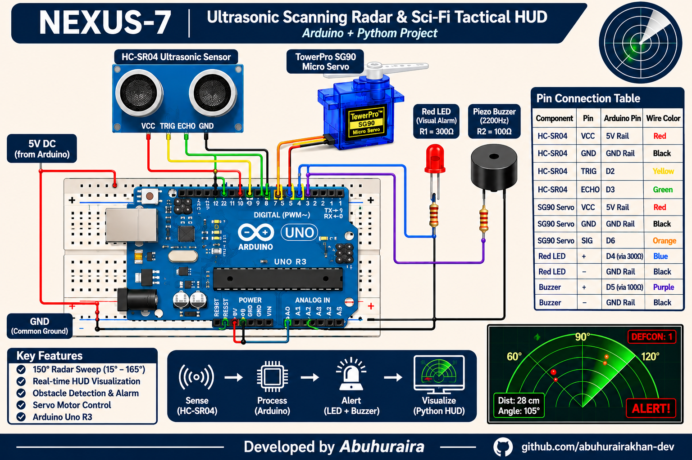

# Full Circuit Diagram & Electrical Engineering Guide
### Project: Arduino Ultrasonic Scanning Radar & Alarm System

---

## 1. System Architecture & Block Diagram

```mermaid
flowchart TD
    subgraph Power["Power Distribution Rail"]
        VCC["Arduino +5V Rail"]
        GND["Common Ground Rail (GND)"]
    end

    subgraph Controller["Microcontroller Unit (MCU)"]
        UNO["Arduino Uno R3 (ATmega328P @ 16MHz)"]
        D2["Pin D2 (TRIG Output)"]
        D3["Pin D3 (ECHO Input)"]
        D4["Pin D4 (LED Output)"]
        D5["Pin D5 (Buzzer PWM)"]
        D6["Pin D6 (Servo PWM)"]
    end

    subgraph Sensors["Acoustic Sensor Subsystem"]
        HC["HC-SR04 Ultrasonic Module"]
        TRIG_IN["TRIG Pin"]
        ECHO_OUT["ECHO Pin"]
    end

    subgraph Actuators["Positioning Subsystem"]
        SERVO["SG90 Micro Servo (Sweeper)"]
        SERVO_SIG["Control Pin (Orange/White)"]
    end

    subgraph Alert["Dual Alarm Subsystem"]
        R1["Resistor R1 (300Ω)"]
        LED["5mm Red LED"]
        R2["Resistor R2 (100Ω)"]
        BUZZER["Passive Piezo Buzzer (2200Hz)"]
    end

    %% Power connections
    UNO -->|5V Output| VCC
    UNO -->|GND Reference| GND

    VCC ==>|5V Power| HC
    GND ==>|Ground Return| HC

    VCC ==>|5V Power (Red)| SERVO
    GND ==>|Ground Return (Brown)| SERVO

    %% Signal connections
    D2 -->|10µs Active High Pulse| TRIG_IN
    ECHO_OUT -->|Echo Return Pulse Width| D3

    D6 -->|50Hz PWM Sweep (15°-165°)| SERVO_SIG

    D4 -->|Active HIGH Alarm| R1 -->|Current Limited ~10mA| LED --> GND
    D5 -->|2.2kHz Square Wave Tone| R2 -->|Current Limited| BUZZER --> GND
```

---

## 2. Complete Interconnection & Pinout Mapping

| Component | Component Pin | Destination / Arduino Pin | Wire Color Code | Purpose / Signal Type |
|---|---|---|---|---|
| **Arduino Uno** | **5V** | Breadboard Positive Rail (+) | **Red** | Main +5.0V DC regulated power bus |
| **Arduino Uno** | **GND** | Breadboard Negative Rail (-) | **Black** | System common ground reference (0V) |
| **HC-SR04** | **VCC** | Breadboard Positive Rail (+) | **Red** | Sensor power supply (+5V, ~15mA) |
| **HC-SR04** | **GND** | Breadboard Negative Rail (-) | **Black** | Sensor ground reference |
| **HC-SR04** | **TRIG** | Arduino **Digital Pin 2** | **Yellow** | 10µs ultrasonic trigger pulse |
| **HC-SR04** | **ECHO** | Arduino **Digital Pin 3** | **Green** | Echo pulse width proportional to distance |
| **SG90 Servo** | **VCC (Red)** | Breadboard Positive Rail (+) | **Red** | Motor power (+5V DC, ~100-250mA) |
| **SG90 Servo** | **GND (Brown)** | Breadboard Negative Rail (-) | **Black / Brown** | Motor ground return |
| **SG90 Servo** | **SIG (Orange)**| Arduino **Digital Pin 6** | **Orange** | 50Hz PWM position signal (15° - 165°) |
| **Resistor R1** | Pin 1 | Arduino **Digital Pin 4** | **Blue** | Visual alarm trigger line |
| **Resistor R1** | Pin 2 | **LED Anode (+)** (Long leg) | *Direct on breadboard* | 300Ω current limiter (drops ~3.0V) |
| **Red LED** | **Cathode (-)** | Breadboard Negative Rail (-) | **Black** | Short leg connected to Ground |
| **Resistor R2** | Pin 1 | Arduino **Digital Pin 5** | **Purple** | Acoustic alarm frequency line (2200Hz) |
| **Resistor R2** | Pin 2 | **Buzzer (+) Plus** | *Direct on breadboard* | 100Ω current limiter & protection |
| **Piezo Buzzer**| **(-) Minus** | Breadboard Negative Rail (-) | **Black** | Ground return |

---

## 3. High-Resolution Circuit Diagram Images

Crisp, high-resolution ($2400 \times 1500$) circuit diagram images are generated and available in both dark and light themes:
* **Dark Theme Diagram**: [docs/circuit_diagram.png](circuit_diagram.png)
* **Light Theme Diagram (Printable)**: [docs/circuit_diagram_light.png](circuit_diagram_light.png)
* **Vector SVG Schematic**: [docs/circuit_diagram.svg](circuit_diagram.svg)



```
+----------------------------------------------------------------------------------------------------+
|                                    BREADBOARD +5V RAIL [RED]                                       |
+---+--------------------+------------------------+--------------------------------------------------+
    |                    |                        |
    | (5V)               | (VCC)                  | (Red Wire)
+---+----+          +----+-------+          +-----+------+
| ARDUINO|          |  HC-SR04   |          | SG90 SERVO |
|  UNO   |          | ULTRASONIC |          |  SWEEPER   |
|        |          +----+---+---+          +-----+------+
|   D2   |--(Yellow)---->|TRIG   |                | (Orange Wire)
|   D3   |<--(Green)-----|ECHO   |                |
|   D6   |--(Orange)-----+-------+---------------->SIG
|        |
|   D4   |--(Blue)---->[ R1: 300Ω ]---->(+) [ RED LED ] (-)----+
|   D5   |--(Purple)->[ R2: 100Ω ]---->(+) [ PIEZO BUZZER ] (-)---+
|        |                                                         |
|  GND   |--(Black)------------------------------------------------+
+---+----+                                                         |
    |                                                              |
+---+--------------------------------------------------------------+---------------------------------+
|                                    BREADBOARD GND RAIL [BLUE/BLACK]                                |
+----------------------------------------------------------------------------------------------------+
```

---

## 4. Theory of Operation & Engineering Calculations

### A. HC-SR04 Ultrasonic Sensor Subsystem
1. **Trigger Phase**: The Arduino sets Digital Pin 2 (`TRIG`) `HIGH` for $10\,\mu\text{s}$.
2. **Sonic Transmission**: The HC-SR04's internal transducer emits an eight-cycle sonic burst at $40\,\text{kHz}$.
3. **Echo Measurement**: The receiving transducer detects the bounced wave and drives Digital Pin 3 (`ECHO`) `HIGH` for the duration of the sound flight time $t$.
4. **Distance Equation**:
   $$\text{Distance (cm)} = \frac{t_{\mu\text{s}} \times v_{\text{sound}}}{2} = \frac{t_{\mu\text{s}} \times 0.0343\,\text{cm}/\mu\text{s}}{2}$$
   *At standard room temperature ($20^\circ\text{C}$), sound travels at $343.2\,\text{m/s}$ ($0.0343\,\text{cm}/\mu\text{s}$).*

### B. SG90 Micro Servo Subsystem
* Operates on a standard **$50\,\text{Hz}$ PWM signal** (20ms frame period).
* The control pulse width determines shaft position:
  - $\sim 1.0\,\text{ms} \rightarrow 0^\circ$
  - $\sim 1.5\,\text{ms} \rightarrow 90^\circ$ (straight ahead)
  - $\sim 2.0\,\text{ms} \rightarrow 180^\circ$
* Sweeps incrementally between **$15^\circ$ and $165^\circ$** in $1^\circ$ increments every $70\,\text{ms}$, satisfying the HC-SR04 requirement for settling time between ultrasonic pings ($\ge 60\,\text{ms}$).

### C. Red LED Current Limiter (Resistor R1 = 300Ω)
* Supply Voltage $V_{\text{CC}} = 5.0\,\text{V}$
* Standard 5mm Red LED Forward Voltage $V_f \approx 2.0\,\text{V}$
* Desired current $I_{\text{LED}}$ calculated via Ohm's Law:
  $$I_{\text{LED}} = \frac{V_{\text{CC}} - V_f}{R_1} = \frac{5.0\,\text{V} - 2.0\,\text{V}}{300\,\Omega} = \frac{3.0\,\text{V}}{300\,\Omega} = 10.0\,\text{mA}$$
* **Safety Margin**: $10\,\text{mA}$ provides bright, crisp illumination while remaining safely below the ATmega328P's absolute maximum output current of $20\,\text{mA}$ per I/O pin.

### D. Piezo Buzzer Current Limiter (Resistor R2 = 100Ω)
* The Arduino generates a $2200\,\text{Hz}$ resonant square wave using `tone(PIN_BUZZER, 2200)`.
* Passive piezo elements act like small capacitive loads with sharp transition spikes.
* The series $100\,\Omega$ resistor dampens ringing spikes, limits output current to $\le 20\,\text{mA}$, and protects the ATmega328P output driver transistors from transient inductive back-EMF.

---

## 5. Step-by-Step Breadboard Assembly

1. **Power Bus Setup**:
   - Connect Arduino **5V** to the breadboard top red positive rail (`+`).
   - Connect Arduino **GND** to the breadboard top blue/black negative rail (`-`).
2. **Mount the HC-SR04 Ultrasonic Sensor**:
   - Insert the 4 pins across rows 10 to 13 on the breadboard.
   - Wire `VCC` to the `+` rail, and `GND` to the `-` rail.
   - Wire `TRIG` to Arduino **Pin 2**.
   - Wire `ECHO` to Arduino **Pin 3**.
3. **Mount the SG90 Servo**:
   - Fasten the ultrasonic sensor to the servo horn (using double-sided foam tape or a bracket).
   - Wire Servo `Red (5V)` to the `+` rail.
   - Wire Servo `Brown (GND)` to the `-` rail.
   - Wire Servo `Orange (SIG)` to Arduino **Pin 6**.
4. **Install the LED Alarm**:
   - Insert the **300Ω resistor** with one leg connected to Arduino **Pin 4** and the other in an empty breadboard row.
   - Insert the Red LED's **longer leg (Anode +)** into the same row as the resistor.
   - Connect the LED's **shorter leg (Cathode -)** to the `-` ground rail.
5. **Install the Piezo Buzzer Alarm**:
   - Connect the **100Ω resistor** from Arduino **Pin 5** to the buzzer's positive pin `(+)`.
   - Connect the buzzer's negative pin `(-)` directly to the `-` ground rail.

---

## 6. Hardware Troubleshooting & Sanity Checklist

| Symptom | Probable Cause | Quick Fix |
|---|---|---|
| **Sensor reads "out_of_range" everywhere** | TRIG and ECHO swapped | Verify Pin 2 connects to TRIG and Pin 3 connects to ECHO. |
| **LED does not light up during alarm** | LED inserted backward | Reverse the LED legs: the longer leg (Anode) must face the resistor; the flat notch side (Cathode) must face GND. |
| **Arduino resets when servo moves** | Voltage sag from motor stall current | The servo draws peak current during fast movement. Ensure the USB cable provides 500mA+, or add a $100\,\mu\text{F} - 470\,\mu\text{F}$ electrolytic capacitor across the breadboard power rails. |
| **Buzzer emits no sound or just clicks** | Wrong pin or passive/active mismatch | Ensure Pin 5 is used. Verify the buzzer is passive (supports variable frequency AC tones via `tone()`). |
| **Servo twitches but does not sweep** | Loose GND wire | Verify the common ground wire between Arduino GND and the breadboard negative rail is seated firmly. |

